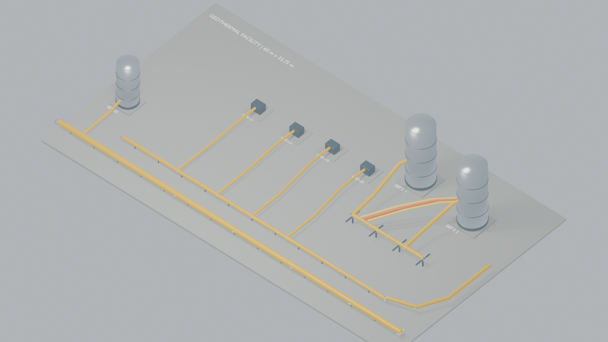
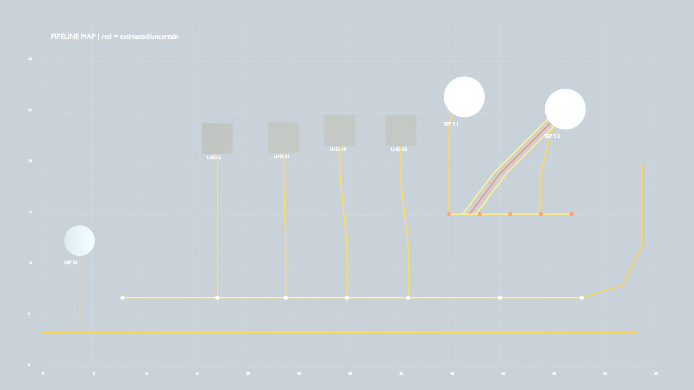

# Geothermal Facility Reconstruction

Coordinate-based Blender reconstruction of a geothermal facility, with an editable 3D scene and a separate top-down pipeline map.

## Files

- `geothermal_facility.blend` — native Blender project. Contains the `GEOTHERMAL_FACILITY_3D` and `PIPELINE_MAP` scenes.
- `geothermal_aerial_render.png` — aerial view of the 3D facility.
- `geothermal_pipeline_map.png` — top-down pipeline layout and coordinate grid.
- `ai-prompt.md` — reconstruction brief and source coordinate estimates.

## Aerial view

## Pipeline map

## Scene notes

- Both scenes use metric units with a scale length of 1.0.
- The site is modeled at 60 m × 33.75 m, with the origin at the bottom-left corner.
- Pipeline curves follow the supplied centerline waypoint estimates. The additional right-side parallel runs are marked as estimated/uncertain.
- The reference photograph was not available to the Blender session, so the model and routes have not been compared against it.
